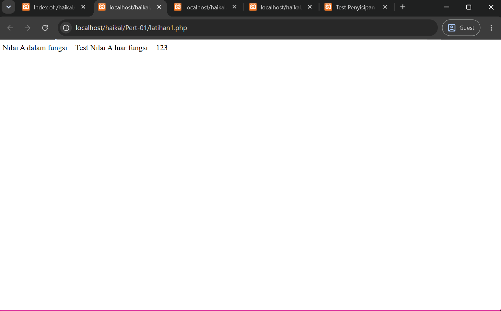
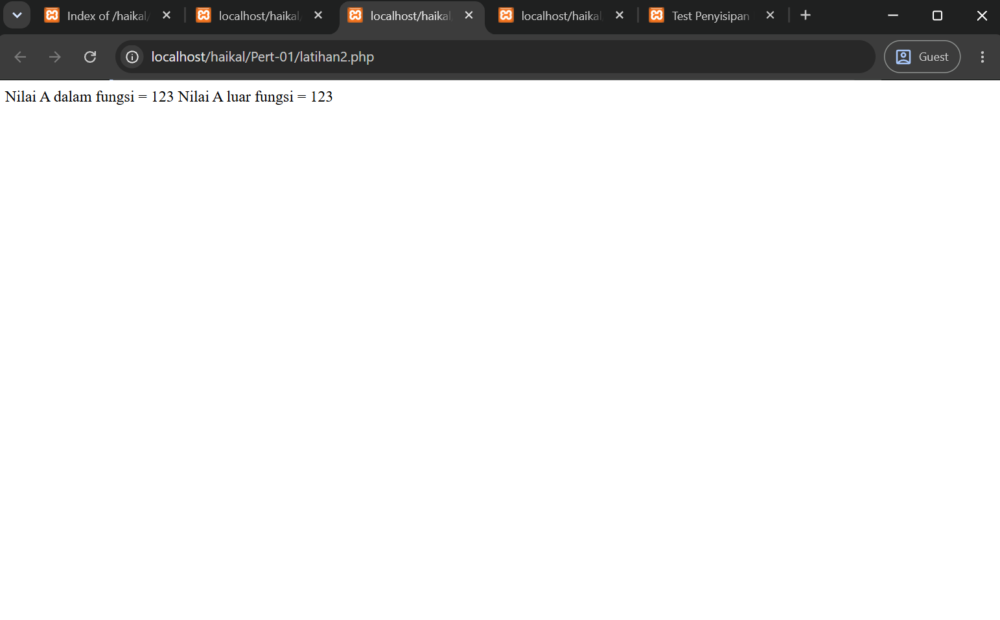
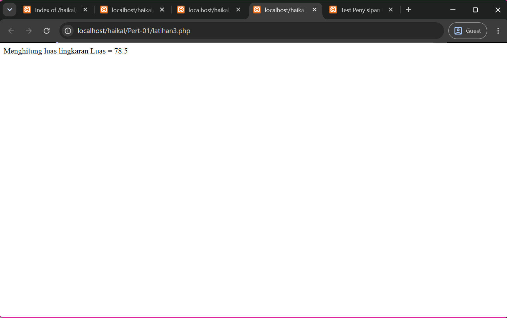
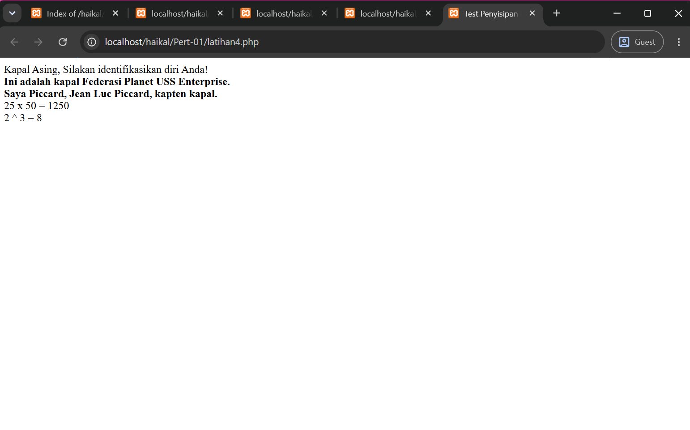

# Pertemuan 01 — Variabel & Konstanta

Latihan dasar PHP: variabel lokal, variabel global, konstanta, dan penyisipan PHP di dalam HTML.

## Daftar File

| File | Deskripsi |
|---|---|
| `latihan1.php` | Perbedaan variabel lokal dan global di dalam fungsi |
| `latihan2.php` | Penggunaan keyword `global` untuk mengakses variabel global dari dalam fungsi |
| `latihan3.php` | Pendefinisian konstanta dengan `define()` dan perhitungan luas lingkaran |
| `latihan4.php` | Penyisipan kode PHP di dalam dokumen HTML, inisiasi variabel, dan operasi aritmatika (`pow()`) |

## Screenshot

