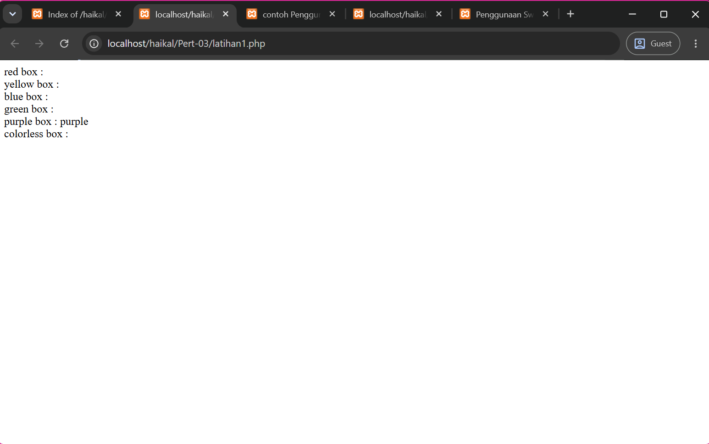
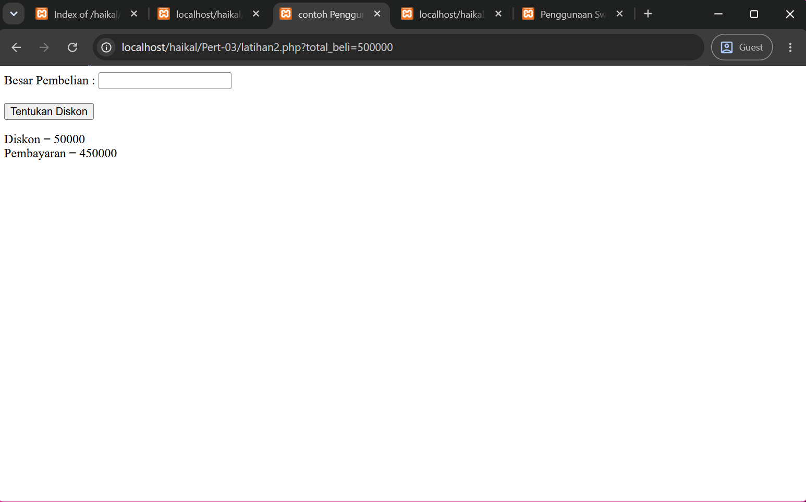
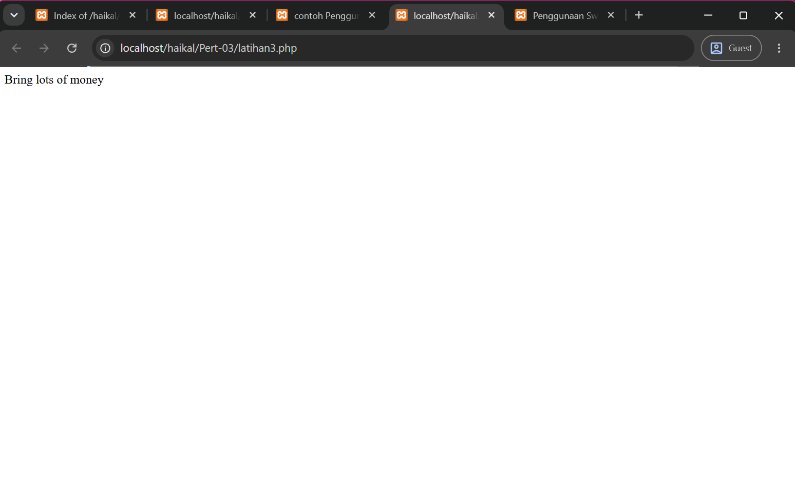
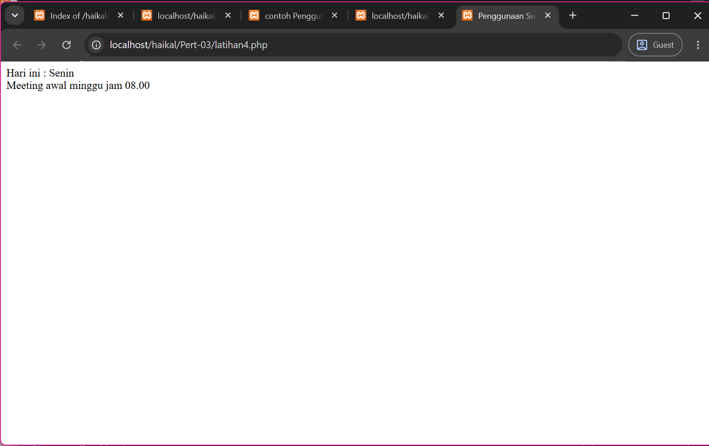

# Pertemuan 03 — Struktur Kontrol (IF & Switch-Case)

Latihan percabangan menggunakan `if-elseif-else` dan `switch-case`.

## Daftar File

| File | Deskripsi |
|---|---|
| `latihan1.php` | Percabangan `if-elseif-else` untuk mengelompokkan warna bola ke dalam kotak |
| `latihan2.php` | Menentukan diskon berdasarkan total pembelian menggunakan form dan `if-else` |
| `latihan3.php` | `switch-case` untuk menampilkan pesan berdasarkan tujuan wisata |
| `latihan4.php` | `switch-case` dengan `date("l")` untuk menampilkan agenda berdasarkan hari |

## Screenshot

