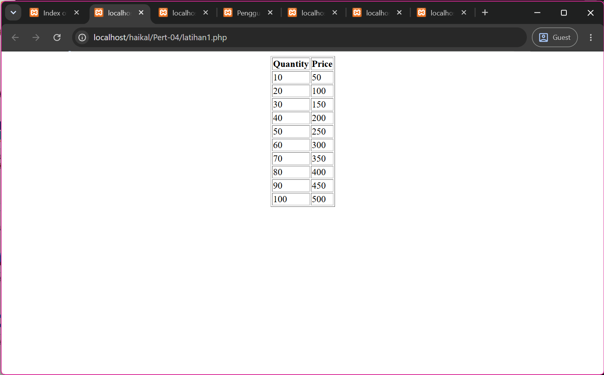
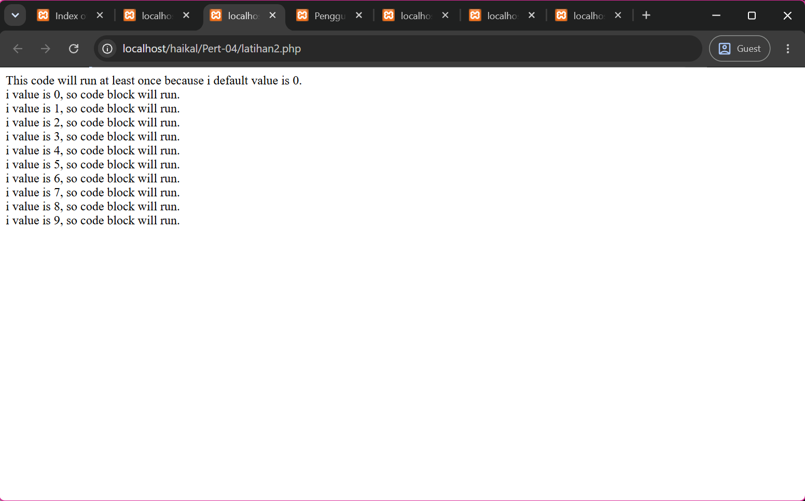
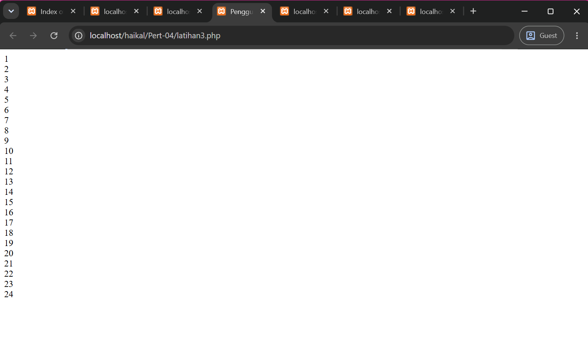
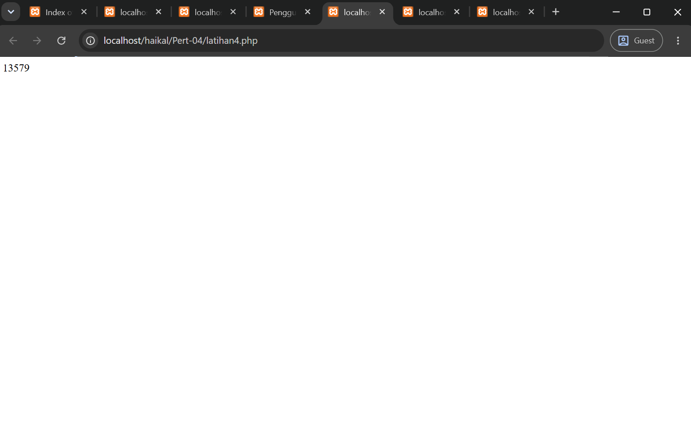
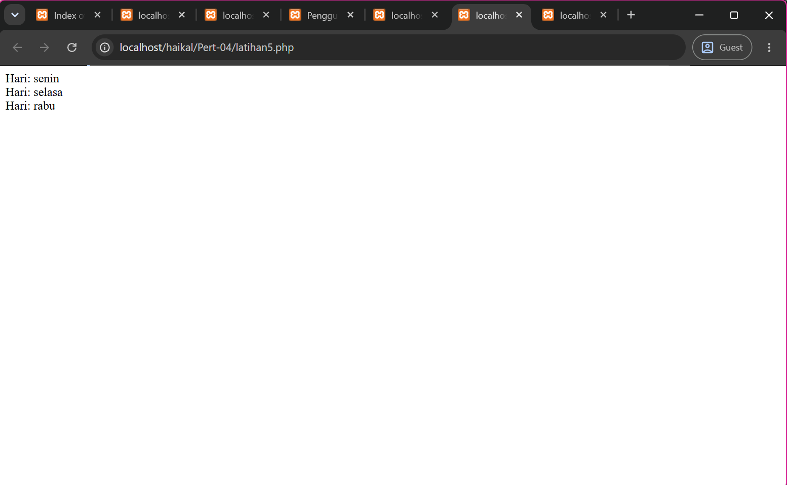
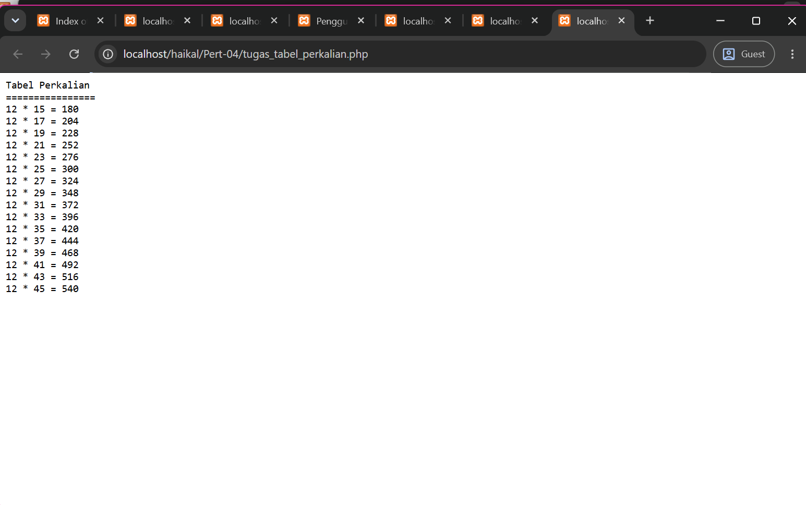

# Pertemuan 04 — Perulangan (Loop)

Latihan berbagai jenis perulangan di PHP: `while`, `do-while`, `for`, dan `foreach`.

## Daftar File

| File | Deskripsi |
|---|---|
| `latihan1.php` | `while` loop — tabel harga kuas berdasarkan kuantitas |
| `latihan2.php` | `do-while` loop — mencetak nilai iterasi minimal satu kali |
| `latihan3.php` | `for` loop — mencetak bilangan 1 sampai 24 |
| `latihan4.php` | `for` loop dengan `continue` — mencetak bilangan ganjil 1–10 |
| `latihan5.php` | `foreach` loop — iterasi elemen array hari |
| `tugas_tabel_perkalian.php` | Tugas: menampilkan tabel perkalian bilangan 12 (kelipatan ganjil 15–45) |

## Screenshot

