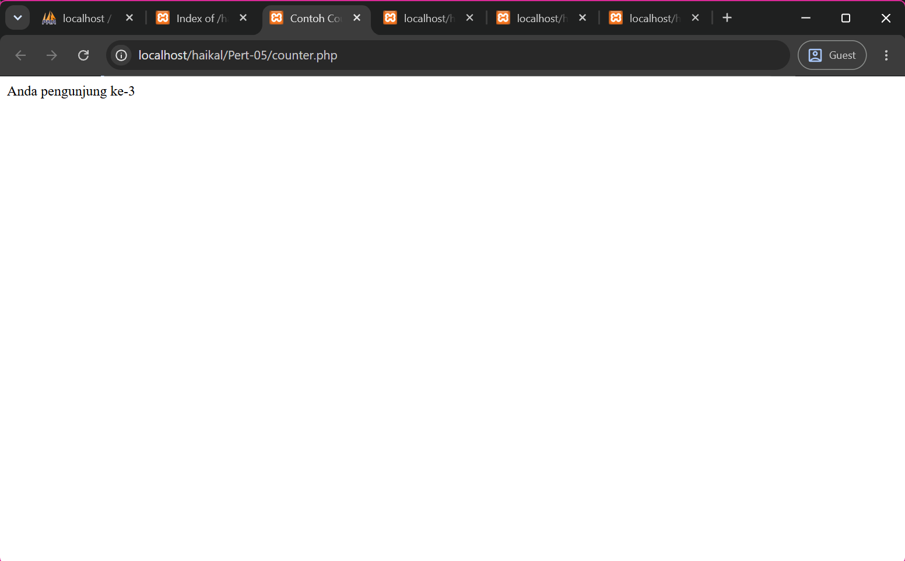
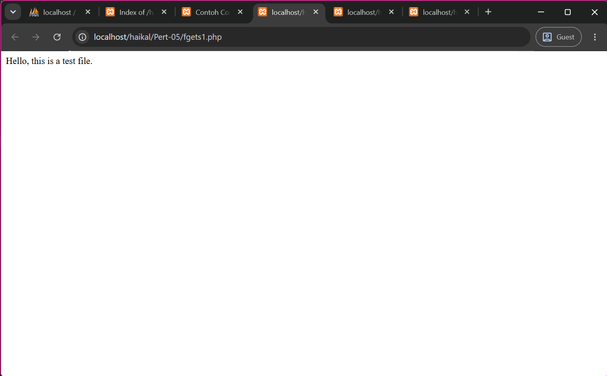
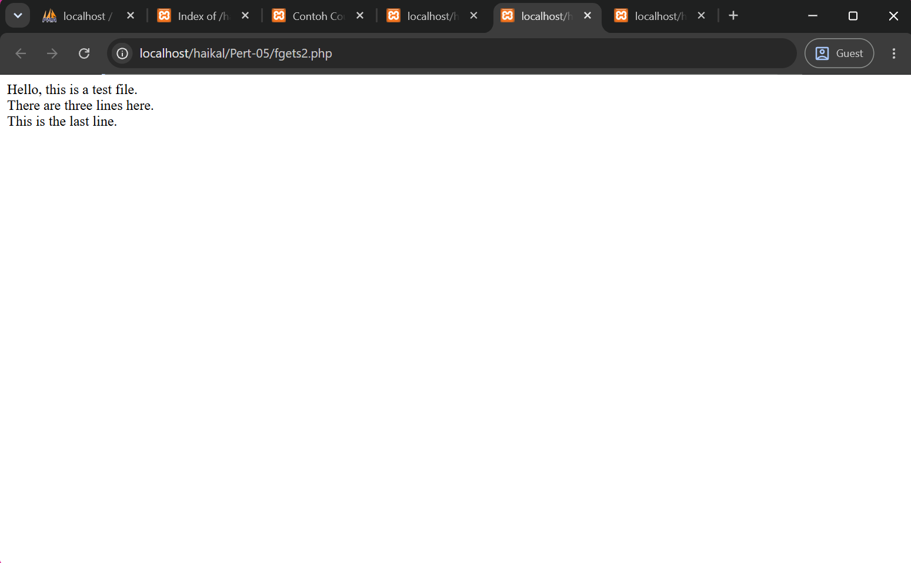
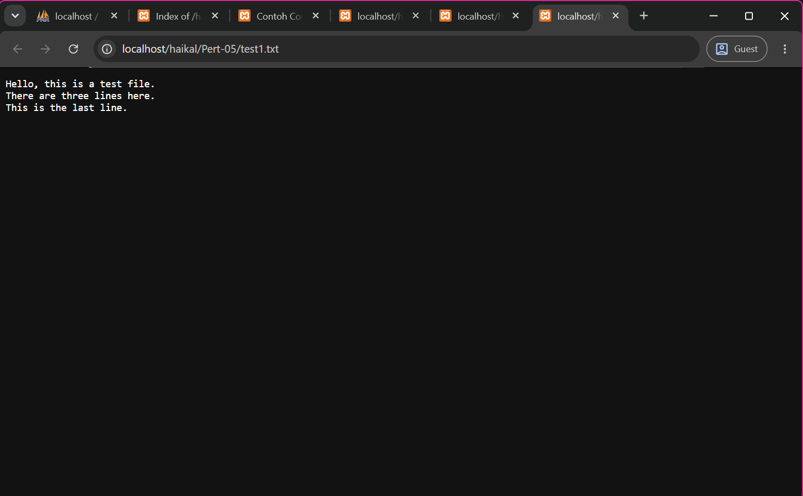

# Pertemuan 05 — Penanganan File (File Handling)

Latihan membaca dan menulis file teks menggunakan fungsi file PHP.

## Daftar File

| File | Deskripsi |
|---|---|
| `counter.php` | Visitor counter — menghitung jumlah pengunjung dan menyimpannya ke file `counter.dat` |
| `counter.dat` | File data penyimpanan angka counter |
| `fgets1.php` | Membaca baris pertama dari file teks dengan `fgets()` |
| `fgets2.php` | Membaca seluruh isi file teks baris per baris dengan `fgets()` dan `feof()` |
| `test1.txt` | File teks contoh untuk latihan baca file |

## Screenshot

