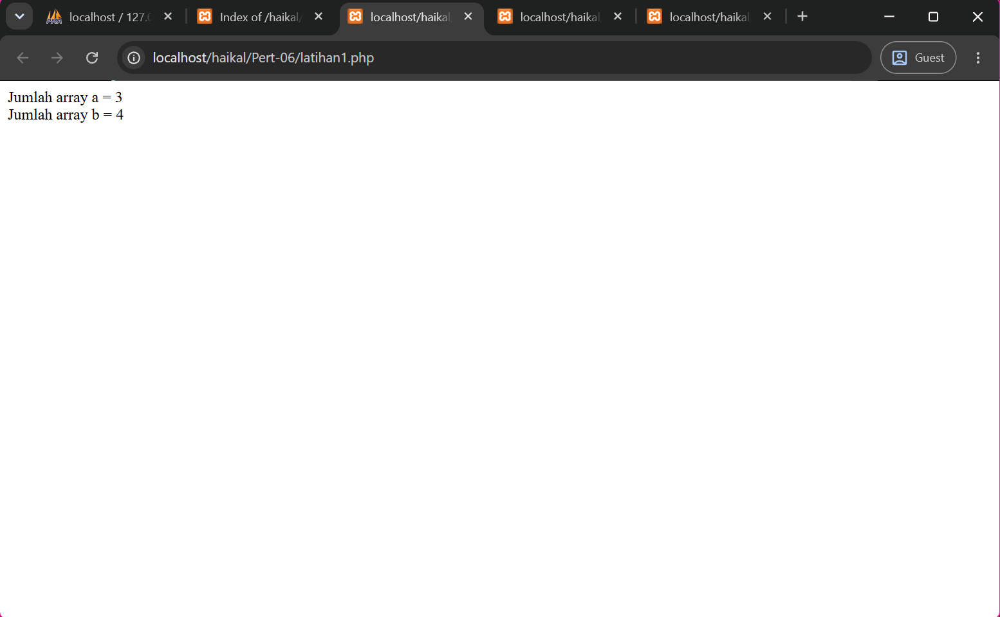
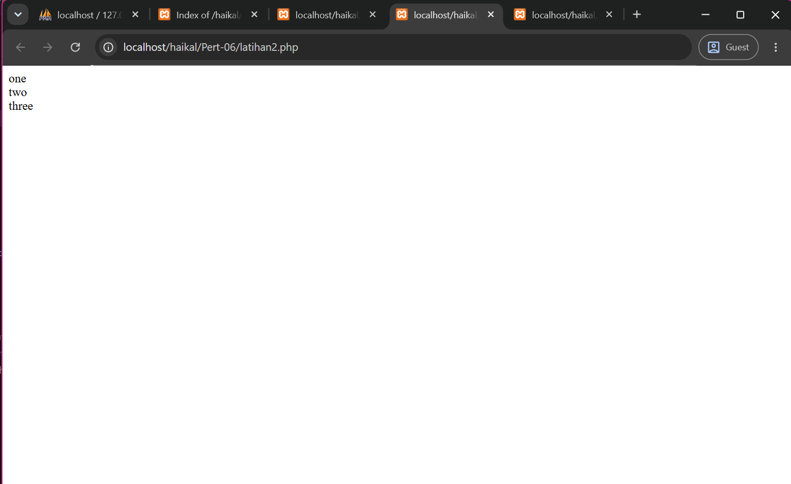
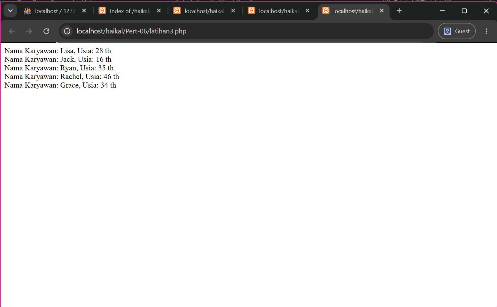

# Pertemuan 06 — Array Dasar

Latihan dasar array berindeks numerik dan array asosiatif.

## Daftar File

| File | Deskripsi |
|---|---|
| `latihan1.php` | Menghitung jumlah elemen array dengan `count()` dan `sizeof()` |
| `latihan2.php` | Iterasi array berindeks numerik menggunakan `foreach` |
| `latihan3.php` | Array asosiatif — menampilkan nama dan usia karyawan dengan `foreach` |

## Screenshot

