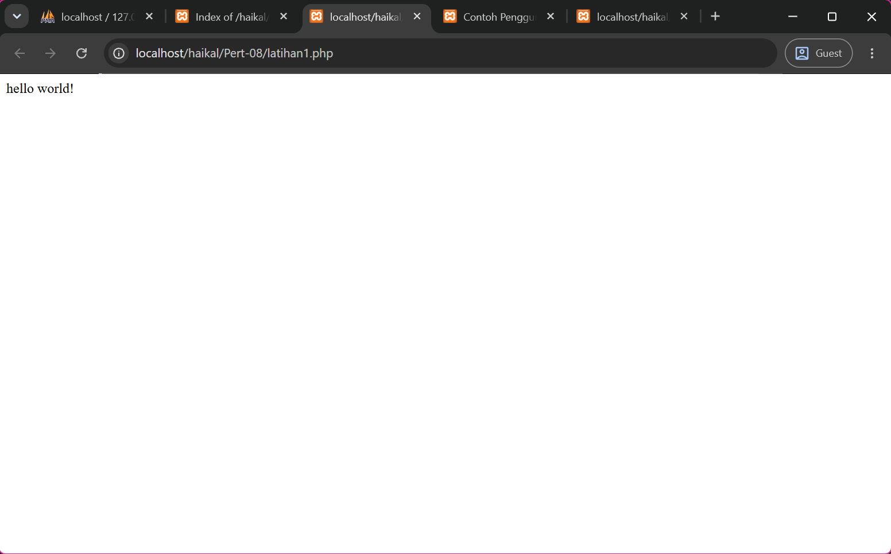
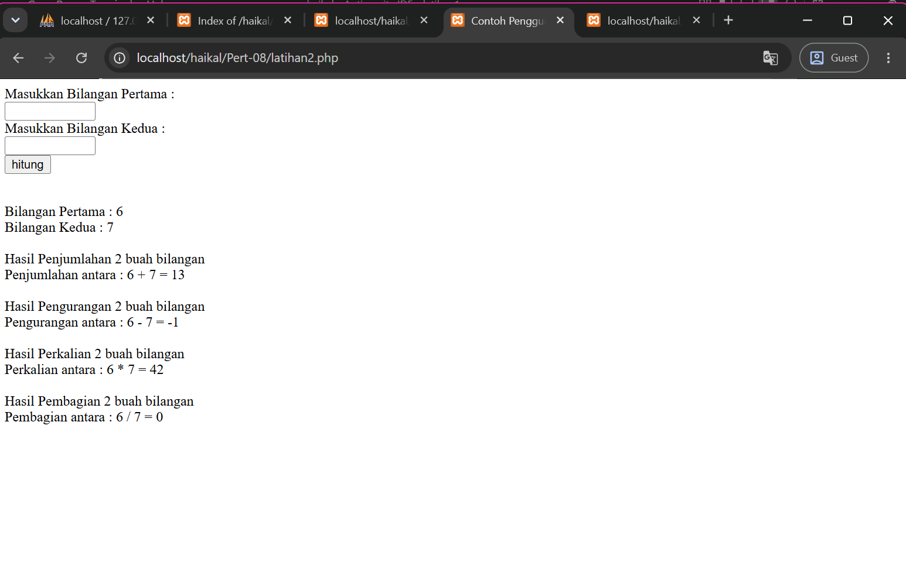
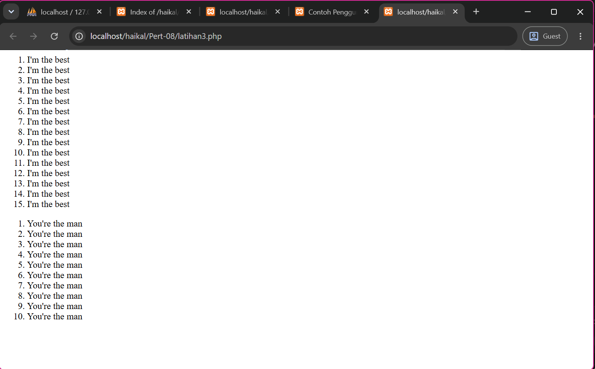

# Pertemuan 08 — Fungsi (Function)

Latihan pembuatan dan penggunaan fungsi (User Defined Function) di PHP.

## Daftar File

| File | Deskripsi |
|---|---|
| `latihan1.php` | Fungsi dasar dengan satu parameter |
| `latihan2.php` | Fungsi aritmatika (jumlah, kurang, kali, bagi) dengan form input dua bilangan |
| `latihan3.php` | Fungsi dengan parameter default — mengulang teks dalam ordered list |

## Screenshot

