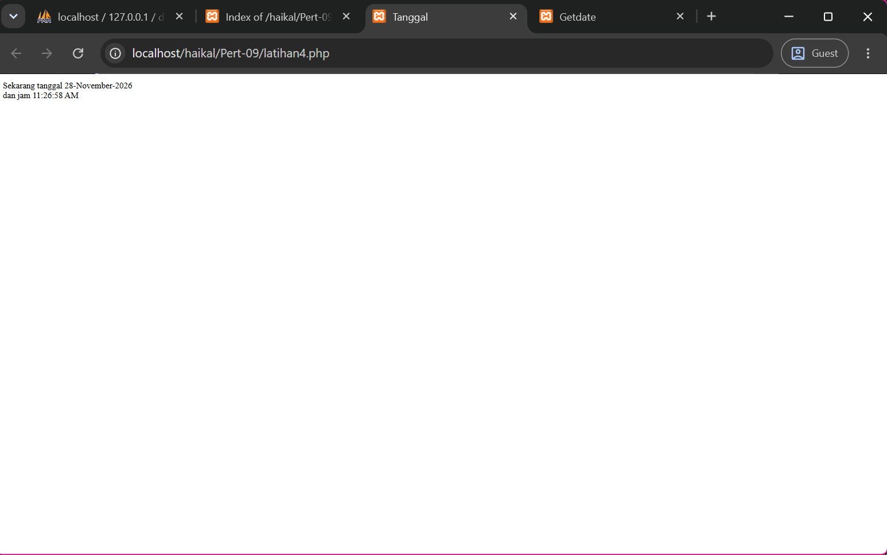
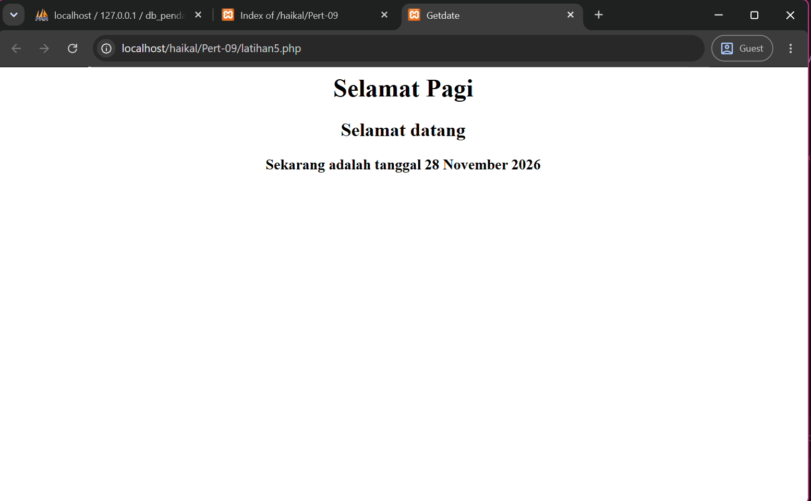

# Pertemuan 09 — Fungsi Tanggal & Waktu

Latihan penggunaan fungsi `date()` dan `getdate()` untuk menampilkan tanggal, waktu, dan salam otomatis.

## Daftar File

| File | Deskripsi |
|---|---|
| `latihan4.php` | Menampilkan tanggal dan jam saat ini dengan `date()` |
| `latihan5.php` | Menampilkan salam (Pagi/Siang/Sore/Malam) secara otomatis berdasarkan jam menggunakan `getdate()` |

## Screenshot

