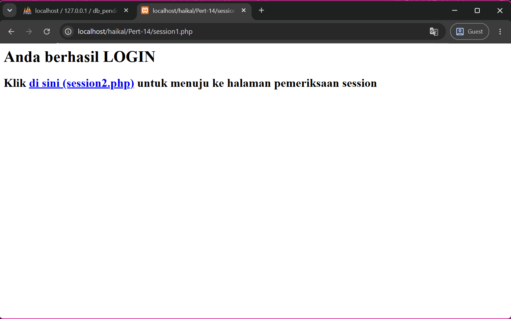
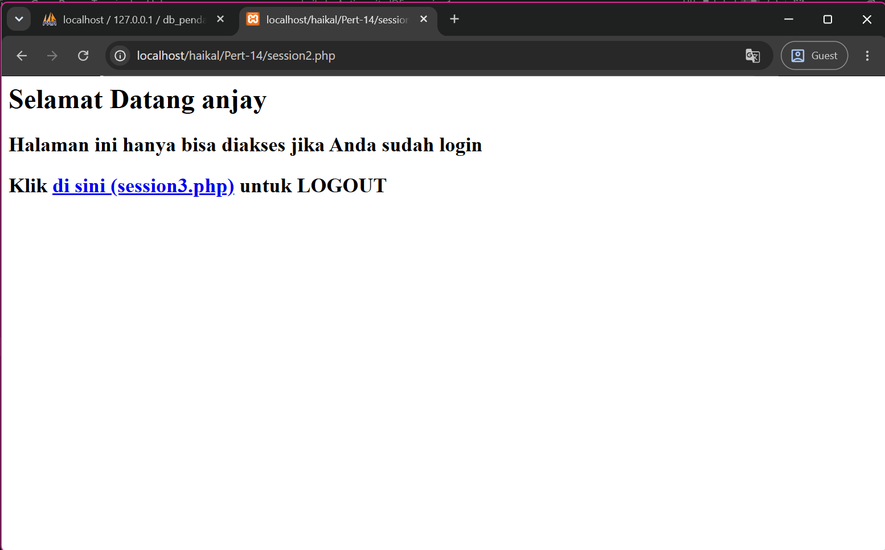
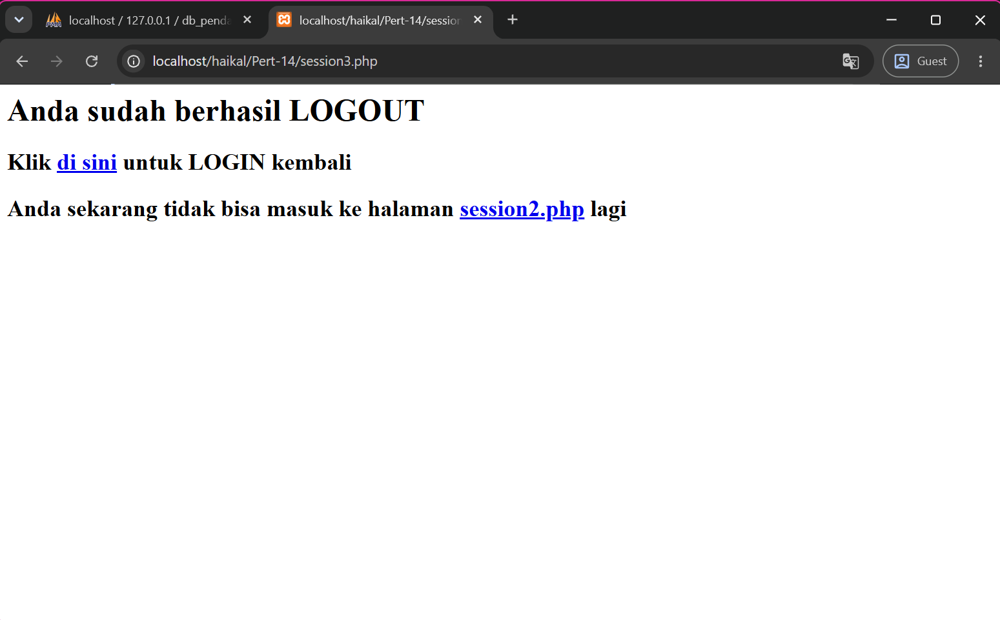

# Pertemuan 14 — Session (Login & Logout)

Latihan manajemen session di PHP: pembuatan session saat login, pemeriksaan session untuk halaman terbatas, dan penghapusan session saat logout.

## Daftar File

| File | Deskripsi |
|---|---|
| `session1.php` | Halaman login — membuat session setelah autentikasi berhasil |
| `session2.php` | Halaman terbatas — memeriksa session, hanya bisa diakses jika sudah login |
| `session3.php` | Halaman logout — menghapus session dengan `session_destroy()` |

## Alur Kerja

```
session1.php (Login) → session2.php (Halaman Terbatas) → session3.php (Logout)
```

## Screenshot




