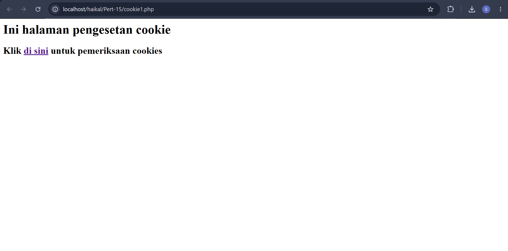
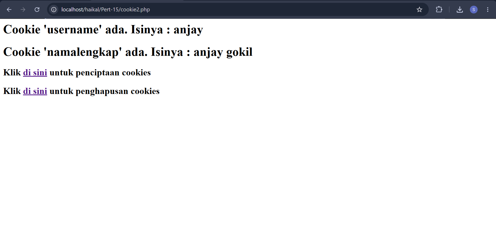
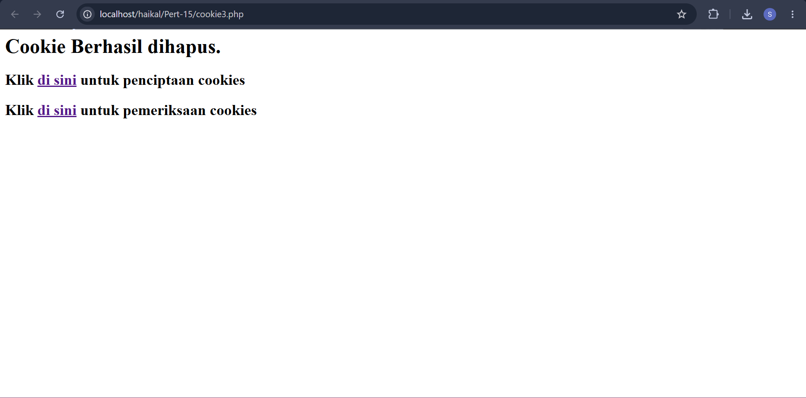

# Pertemuan 15 — Cookie

Latihan pembuatan, pemeriksaan, dan penghapusan cookie di PHP.

## Daftar File

| File | Deskripsi |
|---|---|
| `cookie1.php` | Membuat cookie `username` dan `namalengkap` dengan `setcookie()` |
| `cookie2.php` | Memeriksa apakah cookie ada dan menampilkan isinya via `$_COOKIE` |
| `cookie3.php` | Menghapus cookie dengan mengatur waktu kedaluwarsa ke masa lalu |

## Alur Kerja

```
cookie1.php (Buat) → cookie2.php (Periksa) → cookie3.php (Hapus)
```

## Screenshot




