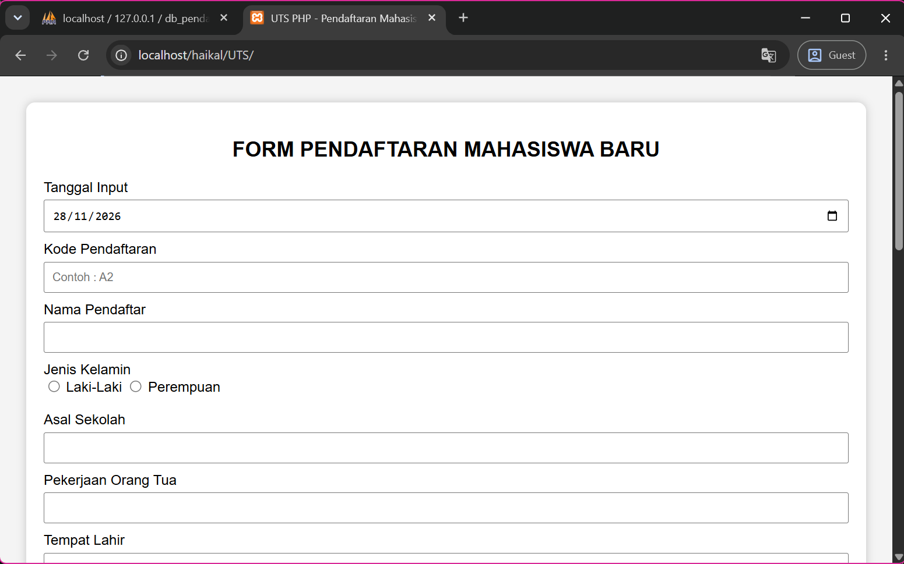

# UTS — Ujian Tengah Semester

Aplikasi Form Pendaftaran Mahasiswa Baru menggunakan PHP (PDO) dan MySQL, lengkap dengan fitur simpan, hapus, dan rekap data.

## Daftar File

| File | Deskripsi |
|---|---|
| `database.sql` | Script SQL untuk membuat database `db_pendaftaran` dan tabel `pendaftar` |
| `index.php` | Aplikasi lengkap: form input, tabel data, dan rekap statistik |

## Fitur

- Input data pendaftar (nama, jenis kelamin, asal sekolah, nilai ujian, dsb.)
- Penentuan **tempat tes** otomatis berdasarkan huruf awal kode pendaftaran (A/B/V)
- Perhitungan **rata-rata nilai** dan **status kelulusan** otomatis:
  - Rata-rata ≥ 70 → Lulus
  - Rata-rata 60–69 → Cadangan
  - Rata-rata < 60 → Tidak Lulus
- Pengecekan duplikasi kode pendaftaran
- Hapus data dengan konfirmasi
- Rekap jumlah pendaftar (Lulus / Cadangan / Tidak Lulus)
- Menggunakan **PDO** dengan **prepared statement** untuk keamanan

## Screenshot

